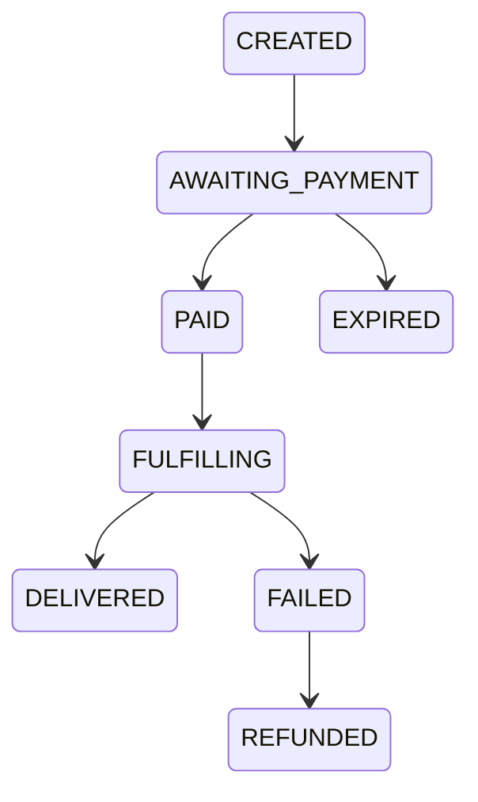

# 07 — Orders

`Docs / 01 Domain / Orders`

Status: draft

## Scope

The order as an aggregate: its fields, its lifecycle, and the financial attribution captured when it is placed. Pricing is owned by [04 Pricing and markup](04-pricing-markup.md); the cost basis by [05 Treasury](05-treasury.md).

## Order

Aggregate root: one client, one product, one player, one sell price, one status. Owns its payment reference and its distributor order id.

| Field | Meaning |
| --- | --- |
| client | The buyer (`Client`). |
| product | The catalogue denomination (`Product`). |
| player | The player identity (`Player`: `userId`, `serverId`). |
| sell price | One sell price for the order. |
| status | The order lifecycle status. |
| payment reference | The provider charge reference owned by the order. |
| distributor order id | The distributor order id owned by the order. |
| `priceMinor` | Sell price in USD minor units. |
| `costMinor` | Distributor cost snapshot at creation, in USD minor units. Nullable for older rows. |
| `coinsConsumed` | Coins consumed for the order. The order stores `coinsConsumed`; if another source names this field `coinsCharged`, `coinsConsumed` is the stored name. |
| `markupBasisPoints` | Markup snapshot applied to the order (basis points). |
| `discountMinor` | Discount amount in minor units. |
| `promoCodeId` | The promo code applied to the order. |
| `playerName` | Verified in-game name returned by the distributor. |
| `wacEgpMinor` | WAC at the moment the order was placed, in EGP minor units. Nullable snapshot. |
| `cogsEgpMinor` | `cost × WAC`, in EGP minor units. Nullable snapshot. |
| `tradingMarginMinor` | Sell price minus distributor cost, in USD minor units. Nullable snapshot. |

## Lifecycle

Only `PAID` may start fulfilment, and `FULFILLING` covers both distributor `PENDING` and `PROCESSING`.

## Financial snapshot

Every order saves the values that must not drift afterwards:

| Field | Meaning |
| --- | --- |
| `costMinor` | Distributor cost in USD minor units. |
| `wacEgpMinor` | WAC at the moment the order was placed. |
| `cogsEgpMinor` | `cost × WAC`, in EGP minor units. |
| `tradingMarginMinor` | Sell price minus distributor cost, in USD minor units. |
| `coinValueMinor` | USD minor units per coin at placement. |
| `priceCoins` | Derived from the USD sell price and the order's coin value; not stored. |
| `currencyReceived` | Recorded on the deposit that issued the coins; an order does not attribute coins to one deposit. |

The order's sell price stays in USD minor units, as it is today; coins are
derived from it.

## Invariants

- Every delivered order has a snapshot and one matching consumption.
- A failed order consumes nothing and refunds at most once.

## Links

- [04 Pricing and markup](04-pricing-markup.md)
- [05 Treasury](05-treasury.md)
- [06 Credits](06-credits.md)
- [03 Glossary](03-glossary.md)
