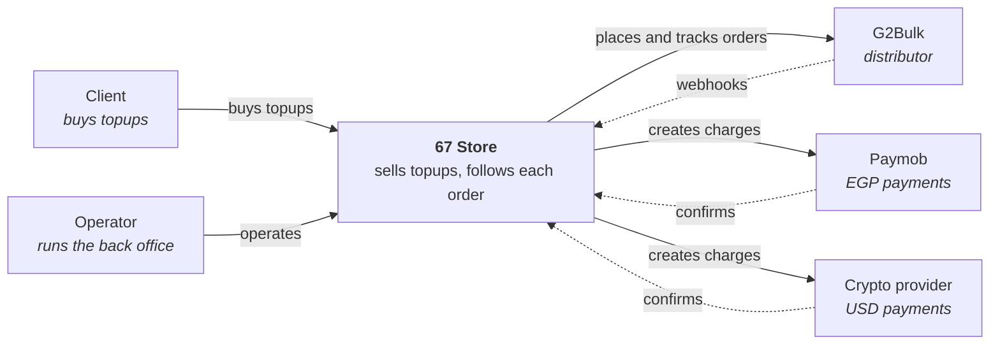
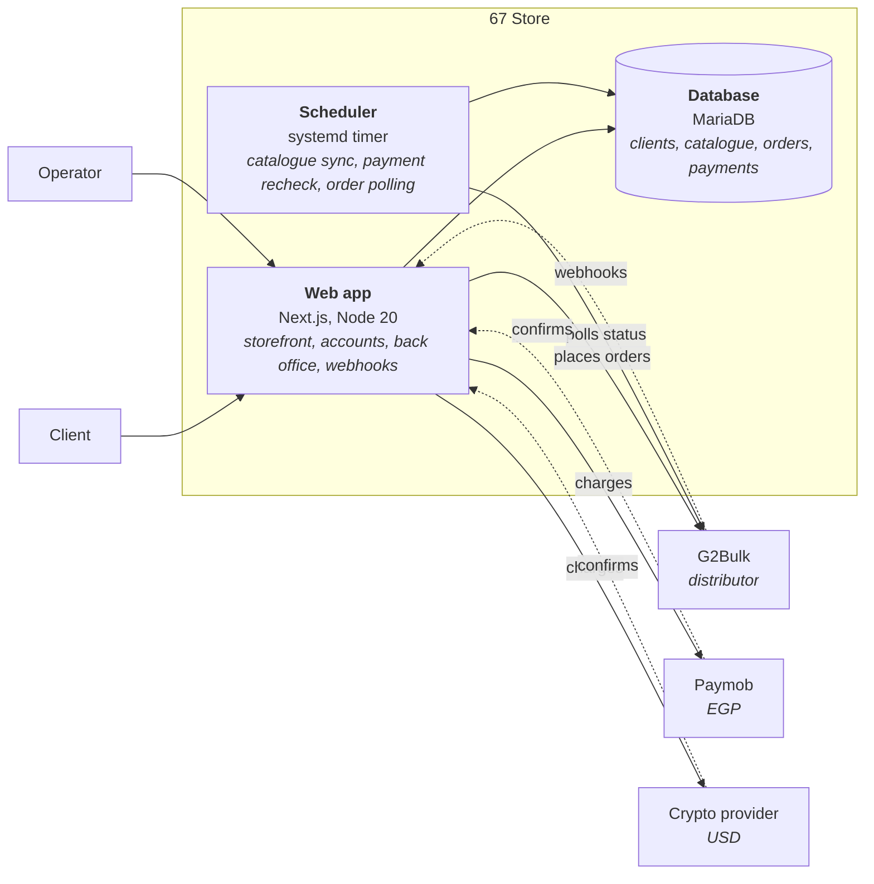

# 01 — Architecture Overview

`Docs / 02 Architecture / Overview`

Status: draft

## Principle

One domain, several surfaces. The domain and its rules are shared; the web app,
the mobile apps and the scripts are thin front ends over it.

## Surfaces

| Surface | When | Role |
| --- | --- | --- |
| Web app | First | The topup website clients use. Includes the distributor API integration. |
| Mobile apps | Later | Same domain, mobile clients. |
| Scripts | Supporting | Operations and tooling. |

## Stack

- Next.js (App Router) and TypeScript in one application that serves both pages and API route handlers.
- MariaDB, the database CyberPanel already provisions. Prisma is the access layer.
- Domain code lives in the packages directly under `src/` (`shared`, `catalogue`, `ordering`, `promos`, `accounts`, `payments`, `fulfilment`, `backoffice`, `wallet`, `jobs`, `integration/g2bulk`, `infrastructure/prisma`) and imports nothing from Next.js, Prisma or the payment SDKs. Route handlers, server actions and admin screens call into it; they hold no business rules.
- Payments: see [05 Payments](../03-specs/05-payments.md).

## Level 1 — System context

Who uses 67 Store and what it depends on.

Solid arrows are calls 67 Store makes; dotted arrows are calls the other side makes
to it.

## Level 2 — Containers

## Deployment

Deployment, environment variables, migrations, job scheduling, and the live/sandbox switch are owned by [05 Deployment](05-deployment.md).

## Boundaries

- The distributor is an external system. It sits behind an adapter — see
  [02 Distributor Integration](02-distributor-integration.md) and the
  [anti-corruption rule](../00-method/02-ddd.md).
- No surface talks to a distributor API directly.
