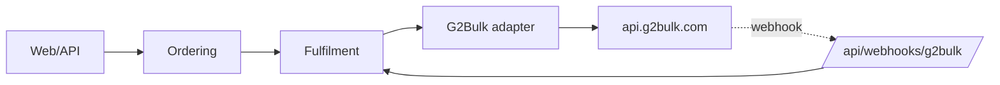

# 02 — Distributor Integration

`Docs / 02 Architecture / Distributor Integration`

Status: decided — G2Bulk

## Intent

G2Bulk is the only distributor in the first release; it sits behind one adapter so no surface and no domain rule depends on its shapes.

## Shape

## Adapter interface

- `listCatalogue(gameCode)` — products and the USD price we are charged.
- `requiredFields(gameCode)` and `servers(gameCode)` — what the checkout must collect for that game.
- `checkPlayer({ game, userId, serverId })` — returns whether the player exists and the in-game name.
- `placeOrder({ gameCode, catalogueName, playerId, serverId, remark, idempotencyKey })` — returns the distributor order id, price and status.
- `getOrder({ distributorOrderId, gameCode })` — current status, message and whether it was refunded.
- `getBalance()` — USD credit remaining.
- `parseWebhook(headers, rawBody)` — verifies the signature and returns the event, or a signature error.

## Mapping

| Ours | G2Bulk |
| --- | --- |
| Order id | `remark`, and the same value as the idempotency key |
| Player.userId | `player_id` |
| Player.serverId | `server_id` |
| Product catalogue name | `catalogue_name` |
| Fulfilment `fulfilling` | status `PENDING` or `PROCESSING` |
| Fulfilment `delivered` | status `COMPLETED` |
| Fulfilment `failed` | status `FAILED`, or HTTP 410 (failed and refunded) |
| Distributor balance | `getMe` `balance`, USD |

## Idempotency

Our order id is a UUID v4 and is sent as the 36-character idempotency key. A retry inside 30 minutes returns the original order instead of charging twice. A retry after 30 minutes may charge again, so after that window the adapter only reads status, never re-places.

## Confirmation and reconciliation

- The webhook is the primary signal. Deliveries are retried for about three days and `event_id` is stable across retries, so handlers are idempotent on it.
- Polling is the fallback: every 30 seconds for five minutes, then every five minutes for 24 hours, until the order reaches a terminal state. Webhooks are missed, and a paid order that never updates is worse than a poll.
- The distributor's webhook delivery log is the audit trail for a delivery that never arrived.
- Orders stuck in `fulfilling` past 24 hours are surfaced in the back office.

## Errors

- 401 and 403 are configuration faults and must alert.
- 400 is our bug and must not retry.
- 404 means the order is not ours.
- 410 is terminal and refunded.
- 429 honours `Retry-After`.
- 5xx retries with backoff.

## Credentials and testing

The API key and webhook signing secret are environment variables, server-side only, with the key IP-locked. There is no sandbox: contract tests replay recorded responses of the public endpoints, and any live call is behind an explicit integration flag.
