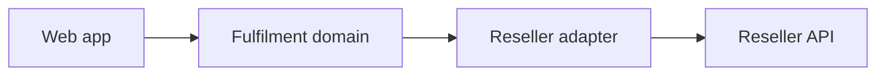

# 02 — Reseller Integration

`Docs / 02 Architecture / Reseller Integration`

Status: placeholder — blocked on the reseller decision in
[01 Domain / Resellers](../01-domain/02-resellers.md)

## Intent

The website connects to reseller APIs to fulfil topups. Each reseller is wrapped
in an adapter so the rest of the system sees one internal model.

## Shape

TBD

## To define

- TBD — adapter interface (quote, place order, get status, balance, catalogue).
- TBD — response mapping and error translation.
- TBD — idempotency key strategy.
- TBD — status reconciliation (polling vs. webhook).
- TBD — credentials and secret storage.
- TBD — sandbox vs. production switching.
