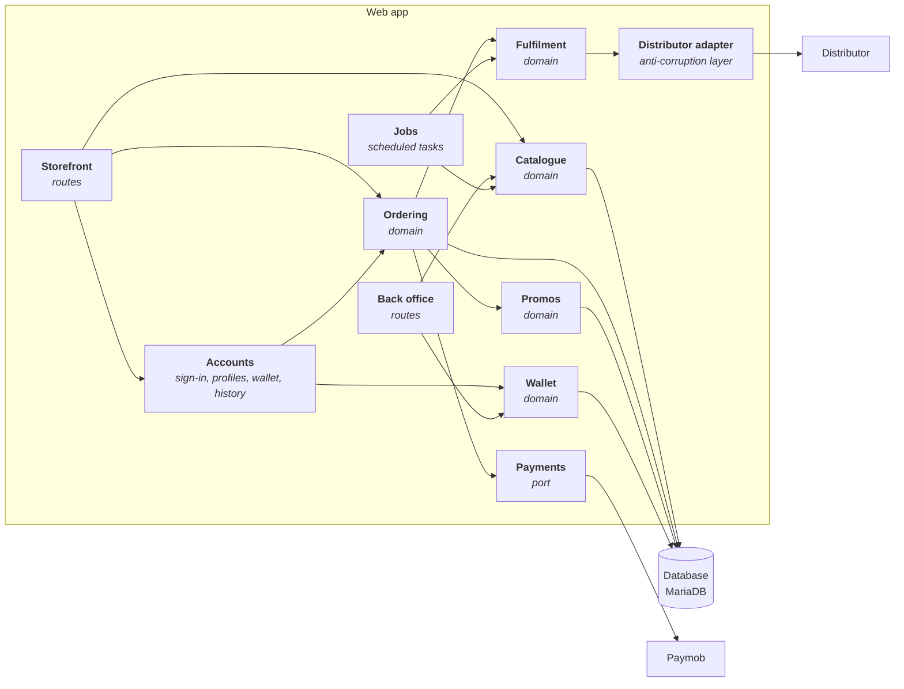

# 03 — Components

`Docs / 02 Architecture / Components`

Status: draft

## Web app components

The components inside the web app. Each bounded context is one component and the
distributor sits behind an adapter, so no domain rule sees the distributor's
vocabulary.

## Code

Not modelled. The glossary in [03 Glossary](../01-domain/03-glossary.md) fixes the
names the classes carry.
