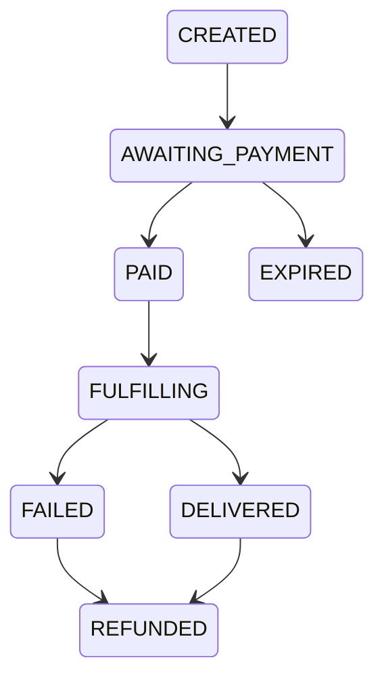

# 01 — Web App

`Docs / 03 Specs / Web App`

Status: in progress

## Scope

The storefront that sells Mobile Legends: Bang Bang topups. Clients buy topups
for their own or others’ game accounts and share the same storefront and account.
A client may register an account that keeps its order history and saved
preferences; a client can still check out as a guest. One game at launch; other
games are added by enabling another catalogue line, not by new code. Delivery
goes through the distributor, G2Bulk. Stack and deployment:
[02 Architecture / Overview](../02-architecture/01-overview.md).

## Language and direction

Arabic is the site's language and the document carries `lang="ar"` with
`dir="rtl"`. Navigation, tables and layout read right to left; amounts stay
left to right so digits and currency codes read correctly. Interface copy is
Arabic, and a fixed bar above the header states that the site is under review and
that nothing is fully verified. The interface ships its own Arabic typeface, Cairo,
with Noto Sans Arabic as its fallback, so text renders the same on every machine
instead of falling back to a system font.

## Non-goals

- Games other than MLBB.
- Mobile apps.
- Email notifications.
- Multiple admin roles.

## Model

- `Client` — a buyer. Every order names one.
- `Client account` — a registered client: credentials, saved preferences and order history. A `Client` has at most one.
- `Gaming profile` — a saved player identity on an account: label, user id, server id and the verified in-game name returned by the distributor.
- `Wallet` — a client's 67 Coins balance, with an entry per movement.
- `Product` — a catalogue denomination with its distributor id, name and USD cost.
- `Order` — aggregate root: one client, one product, one player, one sell price, one status. Owns its payment reference and its distributor order id. Also carries `priceMinor`, `costMinor` (distributor cost snapshot at creation, nullable for older rows), `coinsConsumed`, `markupBasisPoints`, `discountMinor`, `promoCodeId` and `playerName` (verified in-game name).
- `Payment` — a provider charge against one order: provider, provider reference, amount in minor units, currency, status.
- `Player` — value object of `userId` and `serverId`, validated before payment.
- `Money` — amount in integer minor units plus an ISO currency code. No floating point anywhere.

## Order lifecycle

Only `PAID` may start fulfilment, and `FULFILLING` covers both distributor `PENDING` and `PROCESSING`.

## Routes

| Route | Purpose |
| --- | --- |
| `/` | Catalogue: the MLBB product grid. Each product offers three actions: pay in EGP through InstaPay, pay in USDT through the crypto rail, and pay with wallet coins. |
| `/mlbb/[product]/[method]` | Player step for a product and a method already chosen in the catalogue, where the product is the denomination slug and the method is `instapay`, `crypto` or `coins`. Shows the price, lists the account's saved gaming profiles, accepts a new player id and server id, and offers to save them. |
| `/account/login` | Sign in to a client account. |
| `/account/register` | Create a client account. |
| `/account/profiles` | Add, list and remove gaming profiles for the signed-in client. A new profile's player id and server id are checked with the distributor first, and the returned in-game name is stored on the profile. |
| `/checkout/fake/[reference]` | Fake payment page used in fake payment mode. |
| `/account` | Sign-in, wallet balance and movements, saved gaming profiles, order history and preferences. |
| `/order/[token]` | Order status for the client, reachable only by an unguessable token. |
| `/management/*` | Back office, behind a single admin login — see [06 Back Office](06-back-office.md). |

## Checkout flow

1. The client picks a product and a payment method in the catalogue: InstaPay, crypto or wallet coins.
2. The player step shows the product, the total and a method switch between InstaPay, crypto and coins.
3. A signed-in client selects a saved gaming profile, or leaves the selector on a new profile, names it and enters the ids; the profile is saved as part of placing the order.
4. A guest enters the player id and server id without saving a profile.
5. The server validates the player id and zone against the distributor and returns the in-game name; an invalid pair stops the flow with an Arabic error before any order is created. A valid check stores the in-game name on the order, shown on the order page.
6. An optional promo code is entered; it is validated before the order is created and consumed at creation. Invalid, expired, exhausted or inactive codes show a message and create no discounted order.
7. The server prices the order from the synced catalogue increased by the resolved markup from [Pricing and markup](../01-domain/04-pricing-markup.md), applies the promo discount after markup, and never below the distributor cost snapshot. The order stores `priceMinor`, `costMinor`, `coinsConsumed`, `markupBasisPoints`, the discount and the promo code.
8. The payment provider charge is created server-side and the client is redirected to the provider's hosted page. Payment design: [05 Payments](05-payments.md).
9. A verified provider callback marks the order `PAID`.
10. Fulfilment places the order with G2Bulk and the order page follows it to `DELIVERED` or `FAILED`. Distributor decision: [01 Domain / Distributors](../01-domain/02-distributors.md).
11. A failure refunds the client and shows the reason.

## Pricing

Prices come from the synced G2Bulk catalogue. The sell price uses the resolved
markup from [Pricing and markup](../01-domain/04-pricing-markup.md). USD is the
source currency; EGP is derived at the configured rate and stored on the order
with the rate and its timestamp, so a charged amount is always reproducible. The
order stores the applied `markupBasisPoints` and `coinsConsumed` with the price.

## Back office

Admin behaviour (dashboard, users, orders, products, promos, settings) is
specified in [06 Back Office](06-back-office.md). The storefront links to no
admin route.

## Acceptance

- Every product offers three working payment choices.
- Paying with coins debits the wallet by the coin price and leaves the order paid.
- An invalid player id never reaches payment.
- A valid player check stores the in-game name on the order and it is shown on the order page.
- A promo code is validated before the order is created and consumed at creation; an invalid, expired, exhausted or inactive code creates no discounted order.
- A promo discount never takes the price below the distributor cost snapshot.
- An order is never placed with the distributor before its payment is verified as paid.
- Retrying fulfilment never charges twice.
- A webhook delivered twice produces one state change.
- A failed distributor order ends `REFUNDED` and the client sees the reason.
- Every displayed price is reproducible from the stored catalogue amount, markup and rate.
- All clients use the same checkout; the stored price reflects the client's resolved markup.
- One client cannot open another client's order.
- A client can complete a purchase without an account.
- A client sees only its own order history; a guest order stays reachable by its token.
- A guest who saves details is registered and returns to the same player step with the profile saved.
- A saved gaming profile fills the player id and server id without retyping.
- The wallet balance equals the sum of its entries.

## Tests

Unit and contract tests with Vitest, end-to-end with Playwright, per [00 Method / TDD](../00-method/01-tdd.md).
