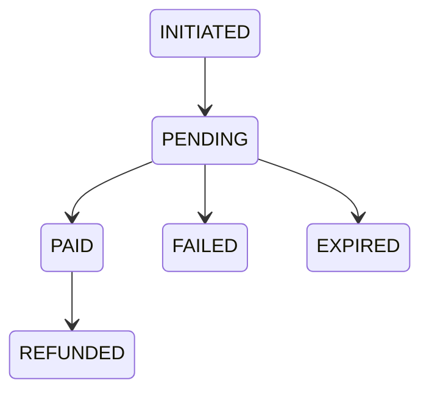

# 05 — Payments

`Docs / 03 Specs / Payments`

Status: in progress

## Scope

Storefront methods: `paymob` (EGP, card and wallet through Paymob hosted checkout), `coins` (in-app coin balance), and `crypto` (off by default; see [Gateway switches](#gateway-switches) and [Crypto](#crypto)).

Provider identity: `PaymentMode` = `fake | instapay | crypto | paymob`; `PaymentProviderName` = `PAYMOB | CRYPTO | COINS`; Prisma `PaymentProvider` = `INSTAPAY | PAYMOB | CRYPTO | COINS` (`INSTAPAY` is kept for historical rows only).

None of the hosted providers hand card data to this app: Paymob hosts its own checkout page; coins debit the wallet.

## Gateway switches

Settings keys and defaults: `gateway:card:enabled` (on), `gateway:wallet:enabled` (on), `gateway:crypto:enabled` (off), `gateway:coins:enabled` (on), `fulfilment:enabled` (on).

Dashboard: `/management/settings` (sidebar entry "الإعدادات") with five checkboxes; saved through `POST /api/admin/settings/gateways`, read through `GET` on the same path, both admin-cookie gated.

Effect (all toggles read per request):
- `gateway:card:enabled` and `gateway:wallet:enabled` decide which Paymob integration IDs are sent with each charge (no restart needed).
- `gateway:coins:enabled` and `gateway:crypto:enabled` are rejected at checkout before any wallet debit and are no longer offered in the storefront (method tabs, product options, method page); the storefront DTO carries `gateways` so the UI follows the switches.
- `fulfilment:enabled = false` stops automatic fulfilment: a paid order stays unfulfilled for manual handling.

## Provider port

The domain sees one interface, implemented per provider:

- `charge({ orderId, amount, currency, returnUrl })` — returns a provider reference and a hosted-page URL.
- `verifyCallback(headers, rawBody)` — returns the provider reference, the paid amount, the currency and the outcome, or a signature error.

Adding a provider means adding an adapter, not editing ordering.

## Paymob

Paymob is the EGP card and wallet provider. It uses hosted checkout so card data never reaches this app.

**Charge.** `POST {PAYMOB_BASE_URL}/v1/intention/` with `Authorization: Token {PAYMOB_SECRET_KEY}`. The body carries `amount` (integer piastres), `currency: "EGP"`, `payment_methods` (integration IDs), `items`, `billing_data`, `customer`, `extras.reference`, `special_reference` (our generated reference), `notification_url` (`{APP_URL}/api/webhooks/paymob`), and `redirection_url` (`{APP_URL}/order/<token>`). The customer is redirected to `{PAYMOB_BASE_URL}/unifiedcheckout/?publicKey=…&clientSecret=…`.

The generated reference (`paymob_<uuid>`) is the payment's `providerReference` and is what Paymob echoes back as `obj.order.merchant_order_id`.

A Paymob charge requires `PAYMOB_SECRET_KEY`, at least one integration ID, and `APP_URL`; otherwise the provider is reported as unavailable. All Paymob env fields are optional at boot.

**Callback.** `POST /api/webhooks/paymob?hmac=…`. The HMAC is SHA-512 over a fixed ordered field list (`amount_cents, created_at, currency, error_occured, has_parent_transaction, id, integration_id, is_3d_secure, is_auth, is_capture, is_refunded, is_standalone_payment, is_voided, order.id, owner, pending, source_data.pan, source_data.sub_type, source_data.type, success`), compared in constant time; the Paymob dashboard's HMAC settings are the source of truth for that order. An invalid signature returns 401 and nothing is confirmed.

After verification the payment is looked up by reference. `amount_cents` and `currency` must equal the stored payment or the callback is rejected with 400 and nothing is confirmed. The event ID is recorded so retries are idempotent (a duplicate returns 200 with no confirm). `success === true` moves the payment to `PAID`, otherwise to `FAILED`. A paid order is fulfilled, and a fulfilment error is logged without failing the callback.

## Coins

Coin payments bypass providers. A client wallet holds a balance in coins; paying with coins debits the wallet at checkout and writes a ledger entry. The coin's value is set by the coin index; see [04 Pricing and markup](../01-domain/04-pricing-markup.md#coin-index). The coin cost of an order is `ceil(USD sell price ÷ coin value)`, rounded up to whole coins. A coin payment with insufficient balance is rejected and the order stays unpaid.

## Crypto

Crypto is off by default and can be enabled with `gateway:crypto:enabled`. `/mlbb/<product>/crypto` still resolves, but the method is not offered while the gateway is off and checkout rejects it before any wallet debit (see [Gateway switches](#gateway-switches)).

## Expiry

`POST /api/jobs/expire-payments` (cron, guarded by `x-jobs-secret`) marks `PENDING` payments older than 60 minutes as `EXPIRED` and returns `{ expired }`. It returns 503 when `JOBS_SECRET` is unset and 401 on a bad secret. The order stays `AWAITING_PAYMENT`.

## Fake rails

`/api/payments/fake/[reference]` and `/checkout/fake/[reference]` return 404 unless `PAYMENT_PROVIDER=fake`. The `fake_` reference prefix is internal and never displayed.

## Money rules

- Amounts are integer minor units plus an ISO currency code. No floating point.
- USD is the source price. EGP is derived at the configured rate with the rate and its timestamp stored on the order.
- The amount charged is always recomputed server-side; a client-supplied amount is ignored.
- A callback that disagrees with the stored amount or currency never marks an order paid.

## States

Only `PAID` releases the order to fulfilment, and `EXPIRED` is reached when the charge window closes without payment.

## Refunds

- A distributor failure refunds the client through the same provider where the provider supports it; otherwise the back office records a manual refund against the order.
- The refund is recorded before the order becomes `REFUNDED`.

## Open

- Paymob integration IDs are not yet filled in.
- Crypto rails are deferred.
- There is no automatic refund (refunds are manual).
- The callback's HMAC field order is verified against a self-signed fixture and must be re-checked with the first real sandbox callback.
