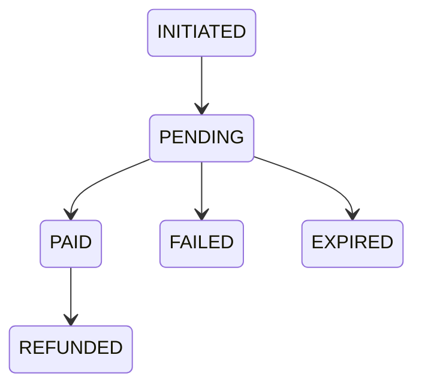

# 05 — Payments

`Docs / 03 Specs / Payments`

Status: in progress

## Scope

Three providers, one port. InstaPay takes EGP from Egyptian clients. A crypto
provider takes USDT from everyone. Coins are paid from a client wallet balance.
None hands us card data: InstaPay and crypto host their own checkout pages;
coins debit the wallet.

In this deployment every provider is fake: `PAYMENT_PROVIDER=fake`, and
`/checkout/fake/*` is only available in that mode. Coin orders and fake
payments auto-fulfil only when `ALLOW_FAKE_FULFILMENT=true`.

## Provider port

The domain sees one interface, implemented per provider:

- `charge({ orderId, amount, currency, returnUrl })` — returns a provider reference and a hosted-page URL.
- `verifyCallback(headers, rawBody)` — returns the provider reference, the paid amount, the currency and the outcome, or a signature error.

Adding a provider means adding an adapter, not editing ordering.

## InstaPay

- Merchant account required.
- The charge is created server-side and the client is redirected to InstaPay's hosted checkout.
- The transaction callback is verified with HMAC-SHA512 over InstaPay's documented field order.
- The amount and currency in the callback are compared with the stored order before the order becomes `PAID`.
- The exact endpoint set is pinned against InstaPay's current documentation when the merchant account is live.

## Crypto

- The provider is not chosen yet; luxtak is under evaluation on usability and cost.
- The adapter must provide a fixed-amount charge with an expiry, a unique address or memo per charge, a signed webhook on confirmation, and a configurable confirmation count.
- Underpayment leaves the order unpaid and overpayment is flagged in the back office, never silently accepted.

## Coins

- A client wallet holds a balance in coins.
- Paying with coins debits the wallet at checkout and writes a ledger entry.
- The coin's value is set by the coin index; see [04 Pricing and markup](../01-domain/04-pricing-markup.md#coin-index).
- The coin cost of an order is `ceil(USD sell price ÷ coin value)`, rounded up to whole coins.
- A coin payment with insufficient balance is rejected and the order stays unpaid.

## Money rules

- Amounts are integer minor units plus an ISO currency code. No floating point.
- USD is the source price. EGP is derived at the configured rate with the rate and its timestamp stored on the order.
- The crypto rail is priced in USDT.
- The amount charged is always recomputed server-side; a client-supplied amount is ignored.
- A callback that disagrees with the stored amount or currency never marks an order paid.

## States

Only `PAID` releases the order to fulfilment, and `EXPIRED` is reached when the charge window closes without payment.

## Refunds

- A distributor failure refunds the client through the same provider where the provider supports it; otherwise the back office records a manual refund against the order.
- The refund is recorded before the order becomes `REFUNDED`.

## Reconciliation

Provider callbacks are the primary signal and are idempotent on the provider reference; a scheduled check re-reads charges left `PENDING` past their window and marks them `EXPIRED` or `PAID`.

## Open

- The crypto provider choice.
- InstaPay merchant account approval.
- The launch markup and EGP rate.

## Acceptance

- A callback with a bad signature changes nothing.
- A callback with the wrong amount or currency changes nothing.
- A duplicate callback produces one state change.
- An order is never fulfilled before `PAID`.
- A refund is recorded before the order reads `REFUNDED`.
- Fake checkout is unavailable unless `PAYMENT_PROVIDER=fake`.
- Auto-fulfilment happens only when `ALLOW_FAKE_FULFILMENT=true`.
