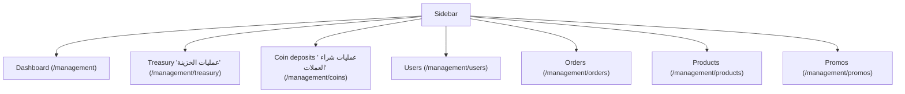

# 06 — Back Office

`Docs / 03 Specs / Back Office`

Status: in progress

## Scope

Admin behaviour of the back office at `/management`. One shared password, no
roles. Customer-facing behaviour is specified in
[01 Web App](01-web-app.md).

## Access

- Entry at `/management/login`: one shared password from `ADMIN_PASSWORD`.
- Session cookie `admin_session` holds an HMAC-SHA256 of `admin-session` keyed
  by the password; 8-hour max age, httpOnly, sameSite lax, secure in
  production.
- `requireAdmin` guards every page and server action; unauthenticated requests
  redirect to `/management/login`.
- All management pages carry `noindex,nofollow`.
- No link from the storefront.

## Navigation

The sidebar carries a compact partition of recorded USDT into reserved and available,
plus the theme switch. The mobile topbar carries the same switch.

## Views

### Dashboard (`/management`)

A financial overview. Top section is two columns: settlement/balance (bridge, partition, WAC, funding link) and a stack of P2P offers + compact coin metrics (index, value, reserved coins, available coins). Empty and error states are explicit: an unavailable live balance shows the recorded side rather than zero, and negative available USDT renders as an overdraft. Below is one combined section: the trend chart together with performance and projections. The chart and performance share a selectable 7/14/30-day trend window (default 30, see [Glossary](../01-domain/03-glossary.md)) chosen with header chips; the window end stays anchored while the width changes. The owner moves the window by dragging the chart (or arrow keys) in whole-day steps across up to 90 days of retained history; it stops at the oldest retained day and at today and never enters the future. The header shows the window dates and a jump-to-latest control. Performance totals (orders, coins sold, profit) are for the current window. Projections remain fixed 7- and 30-day expectations per client (current 30-day coins, current markup, and expected markup and profit after 7 and 30 days). The chart keeps a domain dropdown (live USDT cost with 3-hour min/average/max curves, USDT WAC, profit), one panel at a time. The filters (domain dropdown, profit mode, 7/14/30 width chips, latest) sit in the section header toolbar. When the profit domain is selected, the chart has a profit daily/cumulative toggle (يومي/تراكمي). An empty active domain keeps the axes and grid and shows an in-plot no-data note. The P2P card shows the aggregated range without an offer count and carries the P2P settings dialog for the aggregation window and sync interval. The latest reconciliation status and the alert list are shown. An activity feed shows recent orders, users, deposits, fundings and alerts with links, and recent funding, deposit and price-change history is visible from the dashboard. Includes the catalogue sync trigger, unfulfillable count and balance warnings. On P2P outage the dashboard renders an unavailable state and never crashes. The live-cost legend is always visible (max → avg → min, clickable to show/hide; hidden curves dim, the y-domain recomputes from visible curves, and the tooltip omits hidden rows).

Data comes from `/api/admin/dashboard` (`AdminDashboardDto`). For metric and rule definitions see [05 Treasury](../01-domain/05-treasury.md) and [06 Credits](../01-domain/06-credits.md). For P2P provider design see [03 P2P Rate Integration](../02-architecture/03-p2p-rate-integration.md).

**Visualization grammar.** A stacked partition bar is used only for disjoint parts of one total on the same basis, such as `recorded = reserved + available`. A reconciliation bridge is used for the signed path from recorded to live, not for overlapping balances, and sums as `recorded + free (حر / غير المسجل) = total treasury`. A P2P strip shows min/average/max offers on one graded EGP-per-USDT axis that starts slightly before the minimum and ends slightly after the maximum; WAC is a single value, not a bar. A move bar shows the last index move inside its per-sync cap; the cap is never drawn as an index level. Coins outstanding and available coins are shown as two values, not stacked. On trend charts the x axis draws a light gridline at each day start and labels every third day; times of day appear only in the tooltip. The y axis uses a proportional pad `pad = (max - min) / 6` over the visible curves (data spans 75% of the plot height); a flat line uses a one-unit fallback. The exact padded min/max are drawn as axis grades and interior nice grades fill between them. Legend items (max, avg, min) toggle that curve's visibility; hidden curves dim in the legend, the y domain tightens to visible curves, and the tooltip omits hidden rows. Every graphic has an Arabic text alternative, uses the shared frontend formatter, and uses the existing CSS colour tokens so dark mode and RTL work without a second palette. The shared primitives live in `src/app/management/(shell)/viz/`; the formatter lives in `src/frontend/format.ts`.

Writes: catalogue sync (via the sync trigger).

### Customer coin deposits (`/management/coins`)

A customer's purchase of coins against a cash payment; not treasury funding. Operations page: the header (`عمليات شراء العملات`) carries a compact purchase dialog, and below it one operations table, newest first (date, reference, client, amount paid, price, coins, EGP value, WAC), with the same rows as cards on mobile and `مفيش عمليات شراء` when empty. The dialog takes client id, currency and amount in major units; the only currencies are EGP and USDT, stored as `USD` because the currency code is three letters. Entry is manual — Instapay and Crypto gateways are not live yet. Submitting `recordDeposit` converts the amount to minor units and redirects back to this page with `?ok=deposit` or `?error=deposit`.

Writes: record deposit. See [07 Treasury and credits](07-treasury-and-credits.md) for behaviour and [06 Credits](../01-domain/06-credits.md) for definitions. Reporting metrics live on the dashboard.

### Treasury operations (`/management/treasury`)

Operations only: the funding form and one merged treasury movement. The funding form takes two fields: total EGP paid including fees and USDT received. The log merges funding credits and order-consumption debits sorted newest first (date, type, reference, USDT in, USDT out, EGP, WAC, action). Funding rows have a guarded rollback that hard-deletes the lot and recomputes WAC/recorded/free/available on the next read; the guard refuses when removing the lot would make recorded USDT or the EGP basis negative, or would leave recorded USDT below reserved USDT. Order-consumption rows are not directly deletable: they represent delivered orders and deleting them would desync the treasury from the order/wallet state.

Writes: record funding, guarded funding rollback. See [07 Treasury and credits](07-treasury-and-credits.md) for behaviour and [05 Treasury](../01-domain/05-treasury.md) for definitions. Reporting metrics live on the dashboard.

### Users (`/management/users`, `/management/users/[id]`)

Shows: accounts with email and coin balance, paginated (20 per page). Per-user
page: current balance, the last 20 wallet entries, 30-day consumption, resolved
markup, next breakpoint and a per-client override form. Each user row has
credit/debit coin actions (amount and reason) and the balance is adjusted in
place.
Writes: wallet credit or debit by amount with a required reason, and per-client
markup override; a debit that would make the balance negative is refused. See
[Pricing and markup](../01-domain/04-pricing-markup.md).

### Orders (`/management/orders`)

Shows: orders filtered by status, date range (from/to) and a search across
token, player user id and server id; paginated (50 per page). Discount and
cost columns appear when present.
Writes: none (read-only).

### Products (`/management/products`)

Shows: read-only catalogue with cost (USD), active state and last sync time;
totals, active/inactive counts, oldest and newest sync, and a buyability
partition of buyable, active-but-blocked and inactive products. Buyability is
based on available USDT (recorded − reserved), not total recorded USDT. Sync trigger.
Writes: none directly; active state is owned by the catalogue sync, which is
why there is no manual toggle.

### Promo codes (`/management/promos`)

Create, list, activate/deactivate. Fields: code (normalized,
non-empty), kind (percentage or fixed amount), value (percent 1–100, or a
fixed amount entered in EGP and stored in USD at the current rate), usage
cap (optional), expiry date (optional). Validation errors: empty code,
invalid kind, invalid percent/amount, non-positive usage cap, invalid date,
duplicate code.

Promo-code redemption rules (validation before order creation, consumption at
creation, discount floor at distributor cost) are specified in
[01 Web App](01-web-app.md); not repeated here.

### Pricing controls (dashboard popups)

The dashboard (`/management`) carries small popups for pricing controls:
base markup and the VIP curve sit in the pricing/performance controls, and
the coin-index change limit (`coinIndexCapBps`) sits in the coins card. The
P2P card carries its own settings dialog for the aggregation window (hours, 1-720, default 24) and the sync interval (fixed at 10,800 seconds, i.e. 3 hours); P2P history is hourly with 90-day retention and the current hour is a point immediately; see [03 P2P Rate Integration](../02-architecture/03-p2p-rate-integration.md).
The manual P2P override and USD→EGP rate remain available through `/api/admin/settings`.
The index itself is computed by the catalogue sync. Per-client overrides are
managed on the user detail page. See
[Pricing and markup](../01-domain/04-pricing-markup.md#coin-index).