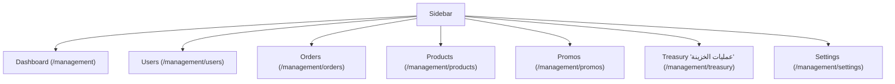

# 06 — Back Office

`Docs / 03 Specs / Back Office`

Status: in progress

## Scope

Admin behaviour of the back office at `/management`. One shared password, no
roles. Customer-facing behaviour is specified in
[01 Web App](01-web-app.md).

## Access

- Entry at `/management/login`: one shared password from `ADMIN_PASSWORD`.
- Session cookie `admin_session` holds an HMAC-SHA256 of `admin-session` keyed
  by the password; 8-hour max age, httpOnly, sameSite lax, secure in
  production.
- `requireAdmin` guards every page and server action; unauthenticated requests
  redirect to `/management/login`.
- All management pages carry `noindex,nofollow`.
- No link from the storefront.

## Navigation

## Views

### Dashboard (`/management`)

A non-tabular financial overview. Shows: KPI cards for distributor USDT balance (with last-updated time), free USDT, reserved USDT with coins outstanding, WAC with EGP basis, available coins for sale, and the P2P USDT/EGP market rate with source and staleness plus break-even; a coverage bar. Four summary cards show trading margin (7/30 days, USDT) and FX result (7/30 days, EGP) separately (never summed), delivered order counts (7/30), and revenue (7/30, USDT). A 30-day trend chart with a domain dropdown (P2P vs WAC default, P2P, WAC, profit), one panel at a time. An activity feed shows recent orders, users, deposits, fundings and alerts with links. Includes the catalogue sync trigger, unfulfillable count and balance warnings. On P2P outage the dashboard renders an unavailable state and never crashes.

Data comes from `/api/admin/dashboard` (`AdminDashboardDto`). For metric definitions see [07 Treasury and Credits](07-treasury-and-credits.md).

Writes: catalogue sync (via the sync trigger).

### Treasury operations (`/management/treasury`)

Operations only: funding form, deposit form, funding/deposit histories, balance line, deposit-rates table, latest reconciliation status.

Writes: record funding, record deposit. Reporting metrics live on the dashboard. See [07 Treasury and Credits](07-treasury-and-credits.md).

### Users (`/management/users`, `/management/users/[id]`)

Shows: accounts with email and coin balance, paginated (20 per page). Per-user
page: current balance, the last 20 wallet entries, 30-day consumption, resolved
markup, next breakpoint and a per-client override form. Each user row has
credit/debit coin actions (amount and reason) and the balance is adjusted in
place.
Writes: wallet credit or debit by amount with a required reason, and per-client
markup override; a debit that would make the balance negative is refused. See
[Pricing and markup](../01-domain/04-pricing-markup.md).

### Orders (`/management/orders`)

Shows: orders filtered by status, date range (from/to) and a search across
token, player user id and server id; paginated (50 per page). Discount and
cost columns appear when present.
Writes: none (read-only).

### Products (`/management/products`)

Shows: read-only catalogue with cost (USD), active state and last sync time;
totals, active/inactive counts, oldest and newest sync. Sync trigger.
Writes: none directly; active state is owned by the catalogue sync, which is
why there is no manual toggle.

### Promo codes (`/management/promos`)

Create, list, activate/deactivate. Fields: code (normalized,
non-empty), kind (percentage or fixed amount), value (percent 1–100, or a
fixed amount entered in EGP and stored in USD at the current rate), usage
cap (optional), expiry date (optional). Validation errors: empty code,
invalid kind, invalid percent/amount, non-positive usage cap, invalid date,
duplicate code.

Promo-code redemption rules (validation before order creation, consumption at
creation, discount floor at distributor cost) are specified in
[01 Web App](01-web-app.md); not repeated here.

### Settings (`/management/settings`)

Shows: the per-game base/VIP curve editor, USD→EGP rate, coin value (EGP per 67
Coin), and the manual P2P override field (`p2pRateEgp`) for the USDT/EGP market
rate.
Writes: those settings, including the manual P2P override. Per-client overrides
are managed on the user detail page. See
[Pricing and markup](../01-domain/04-pricing-markup.md).