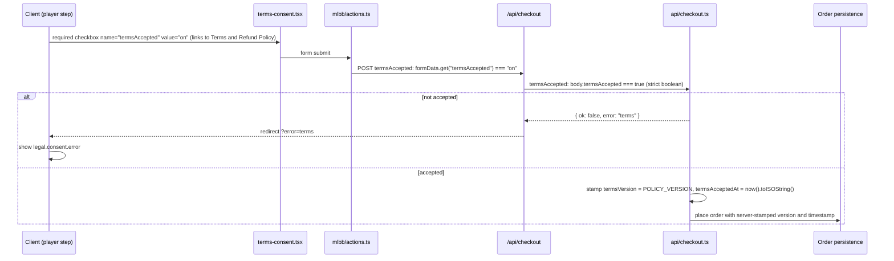

# 09 — Legal pages and checkout consent

`Docs / 03 Specs / Legal pages and checkout consent`

Status: in progress

## Scope

Storefront legal pages and per-order acceptance of the published policy version.

## Single source of truth

`src/shared/legal.ts` exports:

- `POLICY_VERSION` — `"2026-11-11"`.
- `LEGAL_ROUTES` — `terms` `/terms`, `privacy` `/privacy`, `refund` `/refund-policy`, `delivery` `/delivery`, `cookies` `/cookies`, `contact` `/contact`.
- `LegalRouteKey`.
- `LEGAL_FACTS` — operator, country, contact channels, SLAs, refund window, delivery target, currency and policy version used by legal copy, navigation and checkout consent.

Operator facts: 67 Store operating from Egypt (no individual, sole trader, freelancer or company wording). Contact channels: `support@67-store.online` (primary), `ssixsevven1@gmail.com` (alternative), WhatsApp `+20 10 4139 1513` (messages only, no phone calls), 24/7 with a 24-hour reply target.

## Copy

All prose lives in `src/i18n/messages/legal.ts` as flat `ar` and `en` records with the same key set, registered in `src/i18n/dictionary.ts` and covered by `src/i18n/dictionary.test.ts` (Arabic/English parity and non-empty values). Default locale is Arabic.

Key groups: `legal.nav.*`, `legal.common.*`, `legal.<page>.title|intro|sN.title|sN.body`, `legal.consent.*`.

## Routes and layout

`src/app/(storefront)/(legal)/` renders the legal pages in one view with a navigation sidebar (`(legal)/layout.tsx` + `legal-sidebar.tsx`), sticky at desktop width and a horizontal scroll row on mobile. The storefront layout supplies header and footer. `legal-page.tsx` is the shared server component used by the six thin page entries for the routes in `LEGAL_ROUTES`. Loading is covered by the root `src/app/loading.tsx` ancestor fallback, so there is no per-route `loading.tsx`.

## Navigation

The footer "Legal" column renders the six links in fixed order driven by `LEGAL_ROUTES`. The header's avatar menu links to `/terms` as "Policies".

## Consent flow

The client never supplies the policy version or acceptance timestamp.

`Order` carries `termsVersion String?` and `termsAcceptedAt DateTime?` in Prisma via `prisma/migrations/20261111120000_order_consent/migration.sql` (hand-written `ALTER TABLE`; not applied by the dev environment). The domain `Order` carries both as `string | null`, normalised and preserved by every order-copying helper; the Prisma adapter maps them in save, update and hydrate.

## Content decisions

- The store is described only as 67 Store operating from Egypt. No individual, sole trader, freelancer or company wording.
- Player-ID check: before payment the checkout looks the entered player ID up in the game as a convenience that catches typos; it is not a guarantee and the customer remains responsible for the player ID and server.
- Liability is specific, not boilerplate: we owe delivery of the paid digital goods and refunds under the policy; we do not accept responsibility for a wrong player ID/server, topping up an account the customer does not own, game-publisher actions on the account caused by the customer's conduct or an unauthorised top-up, or publisher/payment-provider outages outside our control; liability for an affected order is limited to the amount paid; Egyptian consumer-protection rights are preserved.
- Refunds are manual, within 7 days; failed/undelivered/duplicate orders only; none after successful delivery or a wrong player ID.
- Delivery: digital goods, target 15 minutes.
- Governing law: Egypt. No statute numbers, no named data-protection law or authority. Privacy references "applicable data-protection law in Egypt" and a complaint to "the competent Egyptian authority where applicable".
- Processors: Paymob (payments), G2Bulk (fulfilment) and the hosting provider.
- Cookies: `locale`, `theme`, `preferred-method` and the session cookie; no analytics or advertising cookies.

## Prices

Prices and currencies are shown in the storefront; charging mechanics live in [05 — Payments](05-payments.md).

### EGP

The charged price for Paymob is shown and charged in Egyptian pounds (EGP).

### USDT

A USDT equivalent is displayed at the rate shown at the moment of payment and is used for crypto rails when enabled.

### 67 Coins

A customer can pay from their 67 Coins wallet balance.

The checkout amount at the moment of payment applies; USDT and 67 Coins values are calculated at the rate shown then and can change between visits.

## Boundaries and follow-ups

- No automatic payment-expiry job yet.
- Consent copy hardcodes the 7-day, 15-minute and 24-hour figures as prose while `LEGAL_FACTS` holds the same numbers, so changing one requires changing both.
- Customer-facing labels and the storefront method slug both read `paymob`; `INSTAPAY` survives only as the legacy Prisma `PaymentProvider` value for historical rows.
